This is an account of how I used AI for six days to rebuild a macOS app I loved, and how simple the process was.

## Why

My disk was 99% full, so I opened a chat with an agent to find what was eating it. After a few rounds of `du`, I missed the visualization of Disk Inventory X, an old tool I loved. It draws every file as a rectangle, sized by the space it takes. It still runs, but it is slow. I wanted it back, and fast.

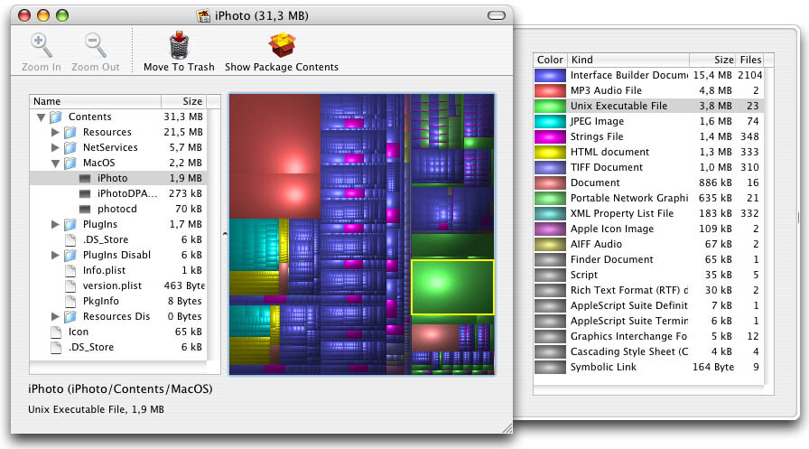

*Disk Inventory X, in a screenshot from its website.*

I had never written Rust or Swift, never built a Mac app, and I have no design skills. Six days later I had a native app with a very fast Rust core and a Swift interface. It was also my first time [building in public](https://x.com/henriquebastos/status/2115413602366591024) for real: I posted every small, incomplete step on X, and it was an amazing experience.

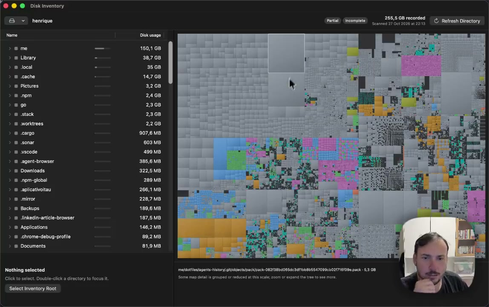

*Dogfooding the first version on 28 Oct. [Video on X](https://x.com/henriquebastos/status/2115257404783014392).*

The agents wrote the code. I steered. Over six days I sent 151 messages. I will share all the numbers below.

These are the moves I used.

## Keep the problem small

I got tired of waiting for `du` to answer each new question, so I asked for a map: "can we have a temporary sqlite db with all existing files with size so we can du once and investigate big files or big dirs iteratively?"

That became a small CLI that recursively scans a directory, stores a map in a quick-to-navigate structure, persists the map in binary form and lets me query it many times.

The map is two flat arrays: a fixed-size record per entry, pointing to its parent, and a block of packed names. One pass adds up every folder, and saving or loading is one sequential write or read. Reopening 5 million entries takes seconds instead of a new scan.

The tool can export the map in CSV, TSV or JSONL, and jq, sort and SQLite do the rest.

When the agent proposed filters and sort options, I said no. Committing to a narrowly scoped core, in the best Unix style, was the single most important design decision.

## Measure before choosing

To make sure the core was fast, I wanted it to run closer to the metal. I said: "I want it to be really as fast as possible." The agent proposed C. I remembered all the recent stories about agents "liking" Rust, so I asked what Rust or Zig would bring, and asked for the experiment in Rust.

The agent's finding: "The biggest expected gains are fewer metadata syscalls and less per-entry allocation, not simply choosing a faster language." The API it found was `getattrlistbulk()`, which returns a batch of directory entries with their metadata in one call, instead of one call for each file. The agent compared both ways in Rust, on three trees:

| Tree | Entries | Workers | Bulk | One call per file |
|---|---:|---:|---:|---:|
| Synthetic test tree | 49,549 | 4 | 21 ms | 38 ms |
| Cargo sources | 86,221 | 4 | 115 ms | 186 ms |
| pnpm store | 497,207 | 8 | 1.15 s | 2.41 s |

Bulk won on every tree. The API mattered more than the language.

The Rust experiment was fast, so I decided to stick with Rust. On my whole disk, it mapped about 5 million entries in about 34 seconds.

## Send the agent to find out

When I did not know something, I asked the agents to find out.

The first treemap came from screenshots on the Disk Inventory X website. It looked right and felt wrong. In Disk Inventory X I could point anywhere and see the exact file; ours showed blocks of folders. Disk Inventory X is [released under the GPL](https://www.derlien.com/), so the agent found its old source on GitHub. The tree, the colors and the shading were there, but the map itself lived in a separate framework that the copy did not include. The agent said it did not know the algorithm instead of guessing.

I had the app installed, so I asked the agent to look inside it. Without running it, the agent listed the method names in the bundled framework. Objective-C keeps them in the binary:

```text
$ nm -m TreeMapView.framework/Versions/A/TreeMapView
-[TMVItem(Private) layoutChilds]
-[TMVItem(Private) arrangeChildsOnRows:childsPerRow:childWidths:rowsAreHoriz:]
-[TMVItem(Private) calculateRow:rowWidth:childsUsed:childWidths:]
-[TMVItem(Private) drawCushionInBitmap:parentCushion:cushionHeightFactor:]
-[TMVCushionRenderer addRidgeByHeightFactor:]
-[TMVItem hitTest:]
-[TreeMapView mouseMoved:]
```

Then it read the machine code of `calculateRow`, the function that builds the rows. The comments after the semicolons are mine:

```text
callq   *%r13               ## Objc message: -[%rdi weight]
addsd   %xmm1, %xmm2        ; add this child's weight to the row
divpd   -0x80(%rbp), %xmm1  ; divide by the total weight
mulsd   -0x38(%rbp), %xmm0  ; scale by the row width
divsd   %xmm1, %xmm0
divsd   %xmm1, %xmm0        ; the row's aspect ratio
movsd   0x5185(%rip), %xmm3 ; a fixed constant
ucomisd %xmm0, %xmm3
ja      0x3552              ; shape too thin: close the row
incq    %r14                ; otherwise, one more child in this row
```

The rule is simple: add files to a row while its shape stays acceptable, then start a new row. I thought small files were hidden. They were not: an 8 KB file covered about 2 pixels. Our map was coarse because of our own limit of 160 rectangles. I loved that the agent learned what to build by studying the binary of a GPL app. Screenshots show the result. The binary shows the rule.

For the interface I needed a designer. I had an agent build a context package for another agent that had never seen our conversation: my very bad first prototype, the old app, my design invariants, and the preferences it could mine from the session. The prompt said: "Disk Inventory X is a reference for the discovery experience, not a design that our app must copy." Claude Design returned an interactive mockup with twelve flows. Then another agent checked it against Apple's Human Interface Guidelines, and where they disagreed, the guidelines won.

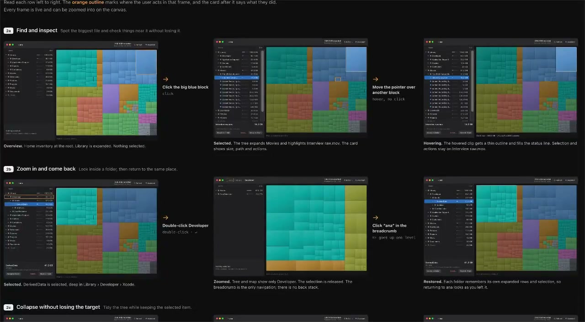

*Every user scenario on one board, ready for comments. [Video on X](https://x.com/henriquebastos/status/2114866444601102841).*

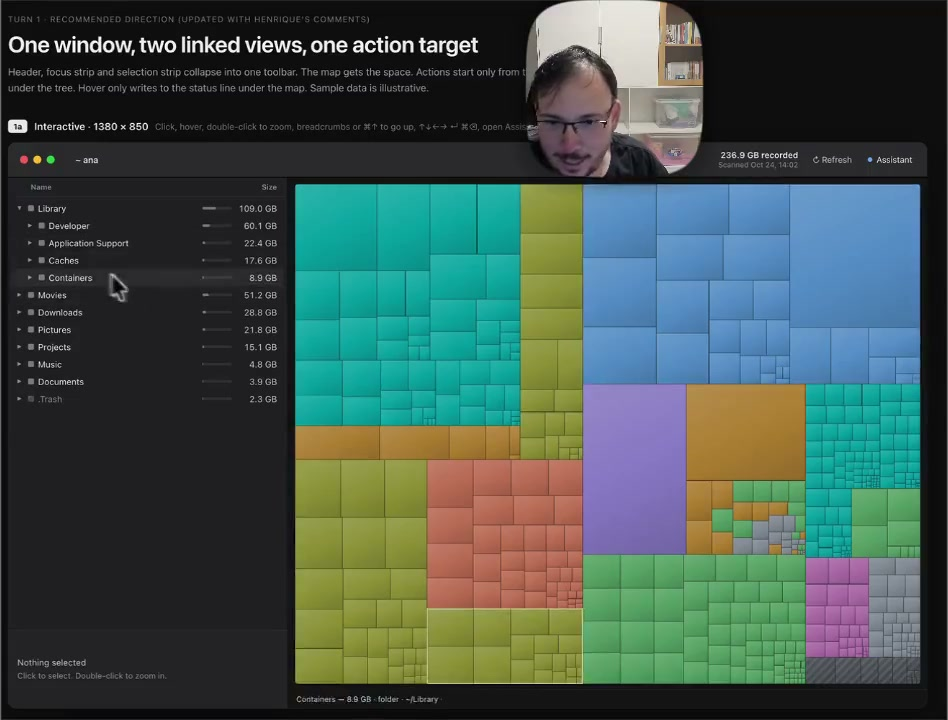

*The interactive mockup. [Video on X](https://x.com/henriquebastos/status/2114869040854315447).*

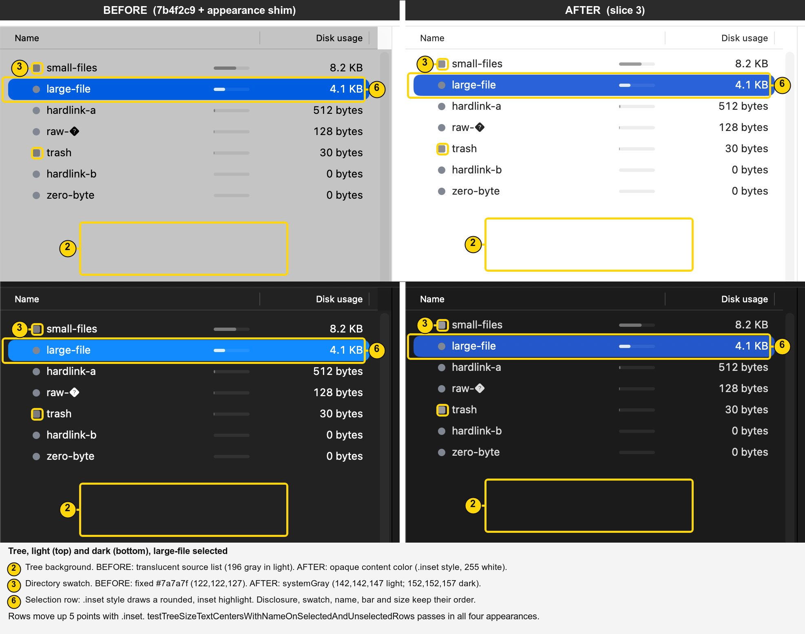

*One page of the guidelines review. [More on X](https://x.com/henriquebastos/status/2115217453382783485).*

Finding out also worked against me. Twice I complained that the rectangles looked misaligned. The second time, the agent showed that the layout matched the designer's code. The problem was my test data: 128 files of almost the same size, all painted the same gray. The fixture was lying.

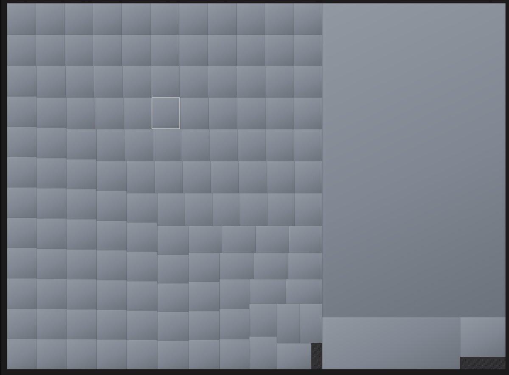

*The "misaligned" map: 128 files of almost the same size.*

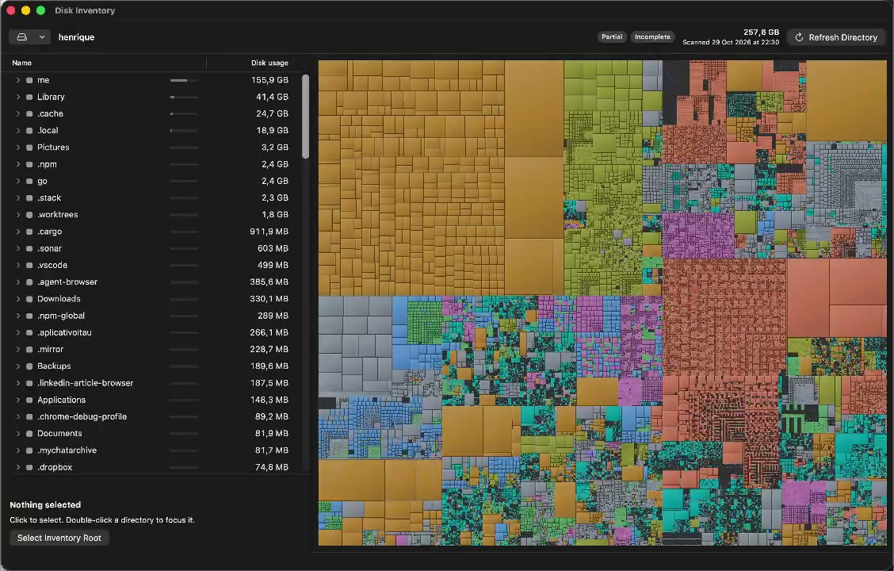

*The same app on my home folder. [Release video on X](https://x.com/henriquebastos/status/2115987197283184731).*

From then on, every change came with before and after screenshots. On a platform I do not know, looking is what I can judge.

This design process was a lot of fun because the agent could present me with options and variations, which allowed me to make decisions after I experimented with the UX. I can't design, but I can tell when I don't like a design, and that is an amazing feedback cycle for learning.

## Be the last guardrail

For some reason the agent assumed we needed all the available metadata about each file and directory. I did not notice that for a while. At some point I saw the agent churning on a file inspector, a side panel with file metadata. I let it go to see where it would arrive. The panel worked, but I noticed the existence of the metadata was adding small complications in different areas of the app. So I course-corrected: "watch out for not complicating the UI, we should keep it as simple as possible. the goal is to find dirs and files using too much space to free them up. low level file information is not needed." I asked it to remove the inspector and everything looked fast and simple again.

The same happened to a navigation history and a layout copied from the old app. Built, seen, removed. This is an area I would investigate more, to learn how to avoid it: how to make scope detours more salient to me so we don't waste energy on what does not matter. But since most of the time the agent was working without my oversight, my time was not wasted, only a few million tokens. Subscriptions FTW!

## Ask for one job per part

Late in the week, the slowest part was clicking. I had set a rule that every visible claim needed a real UI test, one that drives the app with mouse and keyboard. The suite grew to about twenty minutes. "we spend a lot of time clicking on things to validate state." I did not know the fix in SwiftUI, so I asked for an analysis.

The answer was structure. Each part of the screen got its own state, plain values a test can set directly. One shared background worker replaced the ones each view had built. The main model went from about 1,200 lines to under 300. I replaced my rule too: "Each change gets a test in the cheapest layer that can catch it: Rust, then state, then a picture of one part of the screen."

The app ended up in seven layers, and nothing below knows anything above it.

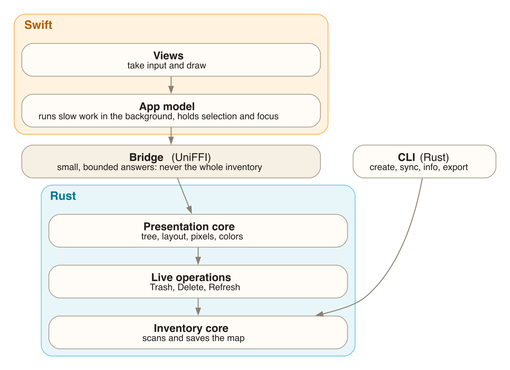
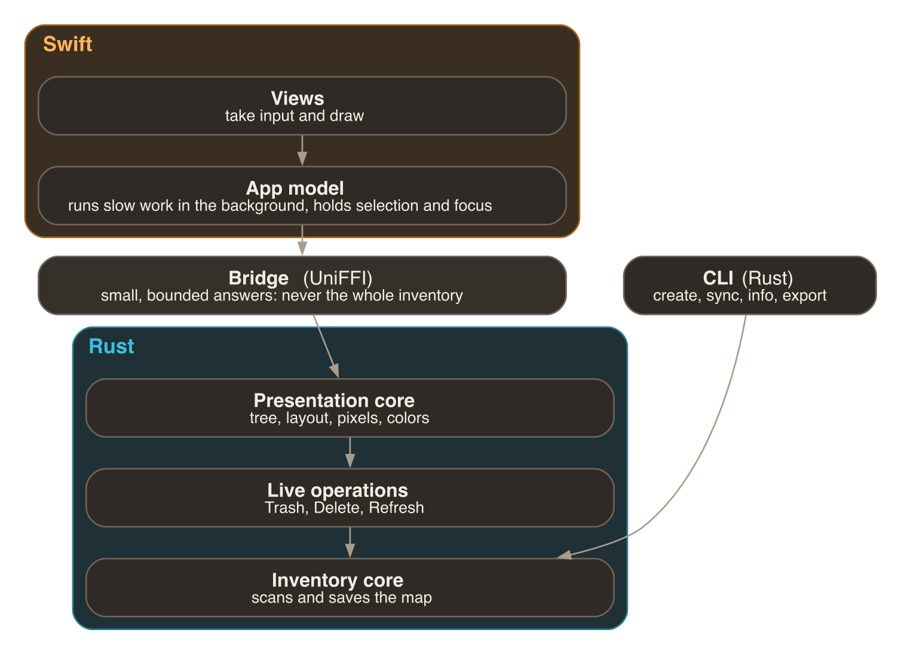

The views take input and draw. A Swift model runs the slow work in the background. A bridge connects Swift to Rust. In Rust, one layer turns the saved map into a tree, a layout, pixels and colors. Another handles Trash, Delete and Refresh. At the bottom, the inventory core scans and saves the map, and the CLI uses that same core.

Swift owns threads and input. Rust owns the data, the geometry, the pixels, the colors and the safety. Even the treemap is drawn in Rust, with a map of which file owns each pixel, so hover is a single lookup.

That design was completely emergent from my constraints and invariants. I did not ask for it explicitly. I did ask for single responsibility, composable units, fast lookups and other higher-level software qualities. The agents built it one responsibility at a time, and I judged whether the next change got easier.

## Read the numbers

I could not judge the structure by reading the code. I could judge it by how the app behaved. It felt fast, and the numbers explained why: the cost of an action follows the size of the change, not the size of the disk. A map of almost six million entries opens in under three seconds. Deleting one item in a folder with a million children costs under a millisecond in the core. Only a full scan pays for the whole disk.

The reproducible fixtures let us measure behavior over and over again. They made the qualities that mattered to me concrete, and that helped the agent protect them.

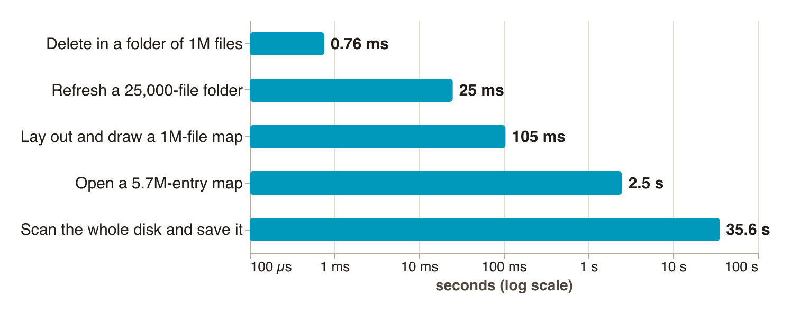
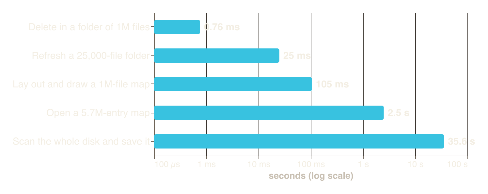

## Strange symptoms are usually repetition

Delete felt frozen. Move to Trash took about four seconds, but the move itself took under a millisecond. The rest was the app walking the same folder up to four times to check that it was safe.

The UI tests were slow. The agents found about 290 calls to an Apple wait that pauses about a second before looking. Replacing it took the suite from about 800 seconds to about 520.

The map flickered. A progress strip changed the map's height, which started another render, again and again.

Each time, the same work was happening more than once.

The agent could spot the problems quickly once I pointed at them. Figuring out how to point at issues and how to let the agent stumble upon the symptoms might increase productivity quite a lot.

## React to failure instead of checking first

The Trash case made me question the checks themselves: "Why aren't we deleting the folder and moving the folder to the trash? Because this how the system works." What if we just tried, and skipped what could not be deleted? I asked the Oracle, a read-only reviewer agent that starts with fresh context, for the downside.

Its answer: "your idea is the recommended design, with one condition." The condition was three fast checks before the confirmation, so a failure halfway would not leave half a folder gone. It also found the late checks safer than the early ones: an early check can go stale before the delete happens.

The checks before the confirmation went from about a second to under a millisecond.

## What I would do differently

- I ran everything in one session, started in my dotfiles folder as a cleanup chat. I would open a fresh session in the repository once the CLI existed.
- I dropped small requests into running work, like a window title and the app icon. The slices grew and ran again. Those belong in a queue.
- I let the environment fight us too long. The screen lock blocked the UI tests for about nine hours. Day one is the time to fix that.
- I accepted slow tests too long, partly because of my own rule.

## The disk

Near the end, a review stopped because the disk was full. The agents building a disk-space tool had filled `/tmp`.

The app does what I wanted. It shows me where my disk went, fast, and lets me clean it up. None of the moves needed me to know Rust or Swift.

## All the numbers

These are the numbers I [posted on X](https://x.com/henriquebastos/status/2115987197283184731) the day the app was ready for a first release.

**My input**

- 151 messages over six days.
- 5,771 words in total.
- 35 messages had three words or fewer.
- 44 messages included a question.
- 11 to 15 hours of estimated chat activity.

**The agents**

- About 94 hours of elapsed activity, including blocked time.
- 1,614 assistant messages in the main session.
- About 1,230 tool calls in the main session.
- 123 subagent runs: 72 workers, 30 reviewers, 10 librarians, 6 Oracle consultations and 5 locators.
- 4,827 subagent turns.
- 76 questions from subagents answered by the main agent.
- About 70 context compactions, 13 model switches and 4 provider failovers.

**Tokens**

- About 924 million tokens processed.
- 96% of them were cache reads.
- About 80% were processed by subagents.
- About 5 million output tokens, including reported reasoning.
- About 6 million processed tokens per message I sent, mostly cached context.

**The code**

- 53 commits in five days.
- About 24,000 lines of code: 15,400 Rust and 8,900 Swift.
- More test code than product code.
- 337 tests: 150 Rust, 154 Swift model and 33 UI.

**Performance**

- 5 million filesystem entries scanned in 34 seconds.
- A 5.7-million-entry snapshot opened in 2.5 seconds.
- A 1-million-file treemap laid out and rendered in about 105 ms.
- A 495,000-entry fixture scanned and saved in 0.61 s, versus 0.88 s for `du -sk`.
